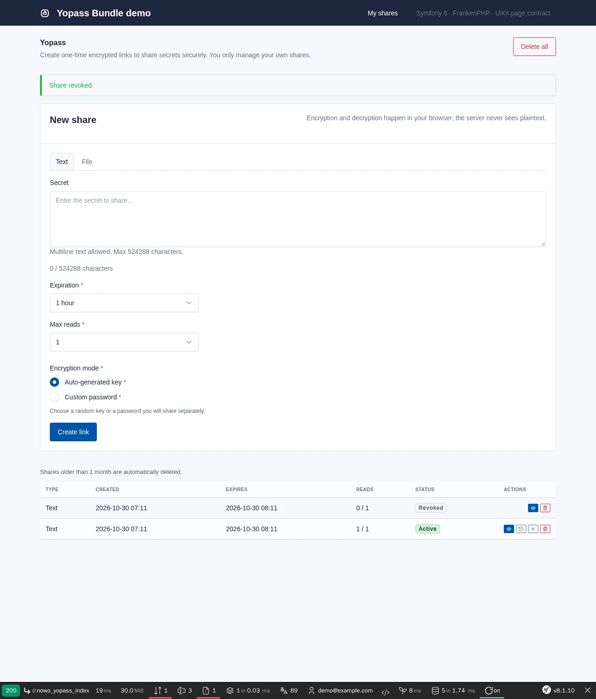
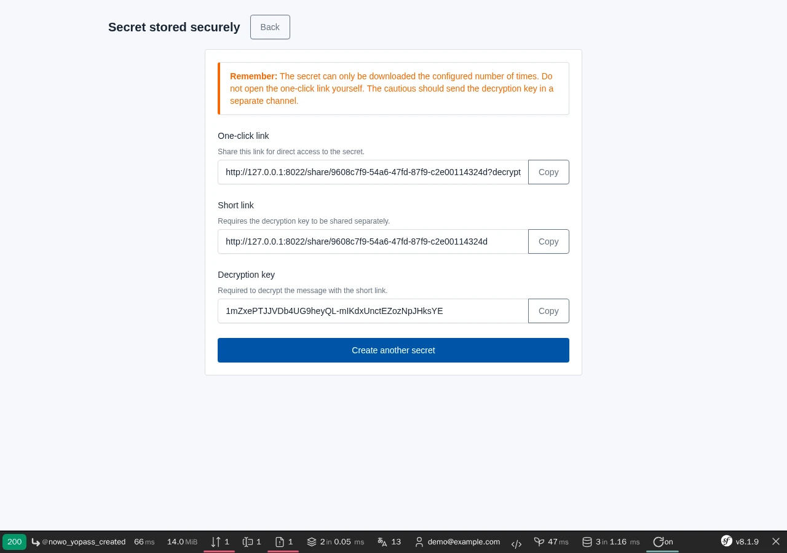
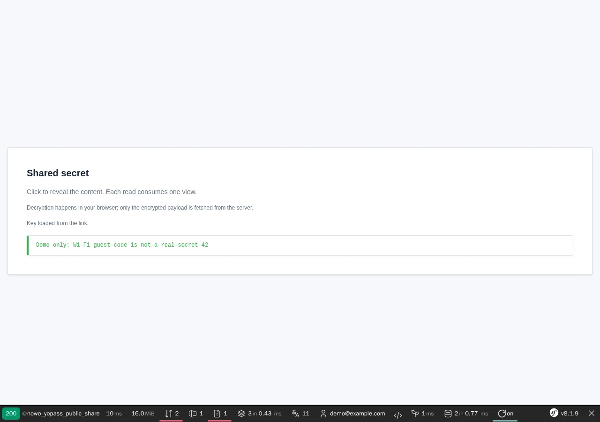

# Yopass Bundle

[](https://github.com/nowo-tech/YopassBundle/actions/workflows/ci.yml) [](https://packagist.org/packages/nowo-tech/yopass-bundle) [](https://packagist.org/packages/nowo-tech/yopass-bundle) [](LICENSE) [](https://php.net) [](https://symfony.com) [](https://github.com/nowo-tech/YopassBundle) [](#tests-and-coverage)

> ⭐ **Found this useful?** Give it a **star** on [GitHub](https://github.com/nowo-tech/YopassBundle) so more developers can find it.

Symfony bundle for **Yopass-style E2E encrypted secret sharing**: client-side libsodium encryption, expiration, read limits, and public reveal pages.


This bundle is **FrankenPHP worker mode friendly**.

<table>
  <tr>
    <td align="center" width="33%">
      
      <br /><sub>Manage page — create panel, shares list, row actions (UiKit list scaffold)</sub>
    </td>
    <td align="center" width="33%">
      
      <br /><sub>Encrypted share created — short link, key and one-click link</sub>
    </td>
    <td align="center" width="33%">
      
      <br /><sub>Recipient reveals the one-time secret, decrypted in the browser</sub>
    </td>
  </tr>
</table>

## Features

- Browser-side encryption (`libsodium` secretbox); server stores ciphertext only
- Text and file payloads (max 512 KB files; file tab requires `file_handler` service)
- Configurable expiration options, max-read limits, list pagination, and retention purge (`nowo:yopass:purge-old-shares`)
- Auto-generated decryption key or custom password mode
- One-click links with the key in the URL fragment (`#decrypt_key=`, never sent to the server; `sharing.allow_embed_in_url`); short links with manual key entry
- Authenticated manage UI + anonymous public reveal/consume routes, on the **UiKit page contract** (list / show scaffolds, guest layout, one host theme for every Nowo bundle; no bundle layout, CSS framework or CDN)
- Configurable routes, table prefix, templates, and pluggable access control
- **Share events** — customize list queries and per-share access (teams, grants, roles) without built-in ACL
- **Public rate limiting** — per-IP limits on anonymous `/share/*` routes (requires `cache.app`)

## Installation

```bash
composer require nowo-tech/yopass-bundle
```

See [Installation](docs/INSTALLATION.md) for Flex recipe, Doctrine schema, routes, and security firewall setup.

## Configuration

```yaml
# config/packages/nowo_yopass.yaml
nowo_yopass:
    user_class: App\Entity\User
    table_prefix: yopass_
    security:
        # Defaults to ROLE_ADMIN since 1.3.0 — set explicitly if you need ROLE_USER
        access_roles: [ROLE_ADMIN]
        roles: { create: [ROLE_ADMIN], list: [ROLE_ADMIN], revoke: [ROLE_ADMIN] }
        access_checker: App\Security\CustomYopassAccessChecker  # optional

# Pages render inside your layouts and theme, configured once in UiKit for every Nowo bundle
nowo_ui_kit:
    css_framework: bootstrap5
    layouts: { admin: 'layouts/admin.html.twig', guest: 'layouts/guest.html.twig' }
```
Full reference: [Configuration](docs/CONFIGURATION.md).

## Usage

- Manage UI: `/tools/yopass` (configurable)
- Public reveal: `/share/{id}` or `/share/{id}#decrypt_key=…` (configurable)
- Pages, view models and data blocks: [Templates](docs/TEMPLATES.md); override Twig: `templates/bundles/NowoYopassBundle/` (prefer the UiKit theme)

See [Usage](docs/USAGE.md) and [Access control events](docs/examples/AccessControl.md).

## Demo

```bash
make -C demo up-symfony8
# Demo started at: http://localhost:8022  →  Yopass CRUD at /tools/yopass (auto-login)
```

The screenshots at the top of this README come from this demo (fake demo text only); refresh them with `make -C demo/symfony8 demo-screenshots` (`make -C demo/symfony8 test-e2e` runs the Playwright happy path).

## Documentation

- [Installation](docs/INSTALLATION.md)
- [Configuration](docs/CONFIGURATION.md)
- [Usage](docs/USAGE.md)
- [Templates (UiKit page contract)](docs/TEMPLATES.md)
- [Contributing](docs/CONTRIBUTING.md)
- [Code of Conduct](CODE_OF_CONDUCT.md)
- [Changelog](docs/CHANGELOG.md)
- [Upgrading](docs/UPGRADING.md)
- [Release](docs/RELEASE.md)
- [Security](docs/SECURITY.md)
- [Engram](docs/ENGRAM.md)
- [Spec-driven development](docs/SPEC-DRIVEN-DEVELOPMENT.md)
- [GitHub Spec Kit](docs/SPEC-KIT.md)

### Additional documentation

- [PSR evaluation (REQ-CS-007)](docs/PSR.md)
- [GitHub Actions CI requirements](docs/GITHUB_CI.md)
- [Share list and access events](docs/examples/AccessControl.md)
- [Demo with FrankenPHP](docs/DEMO-FRANKENPHP.md)
- [FrankenPHP worker audit](docs/FRANKENPHP-WORKER-AUDIT.md)
- [Local file storage (demo default)](docs/examples/LocalStorage.md)
- [AWS S3 file shares example (local, gitignored)](docs/examples/S3.md)

## Tests and Coverage

PHPUnit (unit + integration with Doctrine ORM/SQLite and MongoDB mocks) and Vitest (libsodium crypto helpers and Stimulus controllers on happy-dom). Both gates fail the build below their threshold.

```bash
make test              # PHPUnit
make test-coverage     # PHP coverage + percentage script
make coverage-check    # PHP coverage + 99% statements gate
make test-ts           # Vitest + coverage (all TS sources, 90% gate)
make release-check     # Full pre-release chain
```

| Language | Coverage | Gate |
|----------|----------|------|
| PHP | 99.20% (statements 1729/1743, Lines 99.20%) | `make coverage-check` (≥ 99%) |
| TypeScript | 97.75% (lines 609/623; branches 92.12%) | `vitest.config.ts` thresholds (≥ 90% lines / statements / functions / branches) |
| Python | N/A | — |

## License

MIT — see [LICENSE](LICENSE).
